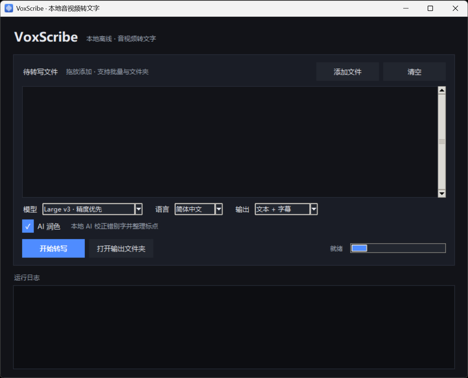

# 🎙️ VoxScribe

> **把视频和录音拖进窗口，文字与字幕留在本机。**
>
> 基于 faster-whisper 的 Windows 本地转写工具，支持批量音视频、TXT / SRT / JSON 输出，以及可选的 Ollama 中文润色。

[](#)
[](#)
[](LICENSE)
[](#)

---

## 📸 实测效果

不用打开命令行，也不用先装 ffmpeg。把文件拖进去，选好模型，点一下「开始转写」：

<div align="center">
  
</div>

---

## 📥 下载

| 下载 | 适合谁 | 包含组件 |
| :--- | :--- | :--- |
| [⬇️ 下载源码 (ZIP)](https://github.com/John-Lixinzhi/VoxScribe/archive/refs/heads/main.zip) | 想直接使用或继续改造 | 图形界面 + CLI + 启动脚本 + EXE 打包脚本 |
| [🛠️ 自行打包 Windows EXE](#-打包成独立-exe) | 不想在目标机安装 Python | PyInstaller onedir 构建，不依赖系统 Python |

> 模型没有塞进仓库。第一次选择某个 Whisper 模型时会自动下载到 `models/`，之后识别不再需要联网。AI 润色是可选功能，不装 Ollama 也能正常转写。

---

## ✨ 核心特性

- 🖱️ **拖进去就能用**：支持文件、多个文件和文件夹拖放；也可以点「添加文件」。常见视频只取音轨，不处理画面。
- 🔒 **识别过程在本机完成**：faster-whisper + CTranslate2 本地推理，音频不会上传给第三方转写服务。
- ⚡ **N 卡加速，没卡也能跑**：CUDA 下默认使用 float16；GPU 加载失败会自动回退 CPU，不会因为没装 CUDA 直接退出。
- 🧠 **可选 AI 润色**：调用本机 Ollama 修正明显同音错别字、补标点、按语义分段；原始识别文本始终保留。
- 📁 **按内容整理结果**：每个源文件单独一个子文件夹，文件夹名根据转写内容生成；重名自动追加 ` (2)`、` (3)`，不覆盖旧结果。
- 🧾 **文本、字幕一起出**：TXT 用于阅读，SRT 可直接导入剪映 / Premiere / PotPlayer，JSON 保留分段与时间信息。
- 🎯 **专有名词可提示**：命令行支持 `--hotwords`，适合人名、型号、课程术语较多的素材。
- 🧰 **GUI 与 CLI 共用一套引擎**：日常拖放用窗口，批量脚本直接调用 `app/voxscribe.py`，行为一致。

---

## 🔬 极简技术架构

```text
┌──────────────────────────────────────────────────────────────────────┐
│                         VoxScribe 本地转写流程                       │
├──────────────────────────────────────────────────────────────────────┤
│ 输入层   文件拖放 / 文件选择 / CLI 参数                              │
│          mp4 · mkv · mov · avi · mp3 · wav · m4a · flac ...           │
├──────────────────────────────────────────────────────────────────────┤
│ 解码层   PyAV → 16 kHz · 单声道 · float32                            │
│          不依赖系统 ffmpeg，也不生成中间 wav                          │
├──────────────────────────────────────────────────────────────────────┤
│ 识别层   faster-whisper → CTranslate2                                │
│          CUDA / float16 → CPU / int8 自动回退                        │
├──────────────────────────────────────────────────────────────────────┤
│ 整理层   分段文本 ──> TXT / SRT / JSON                               │
│          └─ 可选 Ollama ──> 润色文本 + 内容标题                      │
├──────────────────────────────────────────────────────────────────────┤
│ 输出层   output/<内容标题>/<源文件名>.{txt,srt,json,润色.txt}         │
└──────────────────────────────────────────────────────────────────────┘
```

两个实现上的取舍：

1. **不调用外部 ffmpeg**：音轨直接由 PyAV 解码并交给模型，少一个环境变量问题，也不会在临时目录留下巨大的 wav。
2. **润色不覆盖原文**：润色结果单独写成 `.润色.txt`。模型改错了还能对照原稿，不用重新转写一遍。

---

## 🚀 极速上手

### 三步走完，别多做

```text
1. 安装 64 位 Python 3.12，安装时勾选 Add python.exe to PATH
2. 在项目目录执行：py -3.12 -m pip install -r requirements.txt
3. 双击 VoxScribe.bat，把音视频拖进窗口
```

**为什么第一次运行要等模型下载**：Whisper 权重不在 Git 仓库里。默认 `large-v3` 约 3 GB，`large-v3-turbo` 约 1.6 GB，下载一次后会一直复用 `models/` 里的本地文件。

**没有 N 卡要不要装 CUDA**：不用。工具会回退到 CPU，只是速度明显慢一些。使用 NVIDIA GPU 时，建议准备可用的 CUDA 12.x 运行环境。

### AI 润色怎么开

窗口里的「AI 润色」默认勾选，但它不是识别必需项：

1. 安装并启动 [Ollama](https://ollama.com/)，让本机 `127.0.0.1:11434` 服务可用；
2. 保持「AI 润色」勾选，首次运行会自动拉取默认模型 `qwen2.5:7b`；
3. 不想润色就取消勾选，转写流程完全不受影响。

也可以用环境变量换服务或模型：

```powershell
$env:VOXSCRIBE_OLLAMA_HOST = "http://127.0.0.1:11434"
$env:VOXSCRIBE_OLLAMA_MODEL = "qwen2.5:7b"
```

### 命令行用法

```bash
# 单个视频，默认输出 TXT + SRT
python app/voxscribe.py "D:\media\课程.mp4"

# 批量处理，速度优先，并提示专有名词
python app/voxscribe.py "a.mp4" "b.m4a" --model large-v3-turbo --hotwords "Keil STM32 单片机"

# 自动检测语言，TXT 带时间戳，同时保留 JSON
python app/voxscribe.py "meeting.wav" --lang auto --timestamps --format txt,srt,json

# 指定输出位置并开启本地润色
python app/voxscribe.py "a.mp4" --out-dir "D:\transcripts" --polish
```

| 参数 | 作用 |
| :--- | :--- |
| `--model` | `large-v3`（默认）/ `large-v3-turbo` / `medium` / `small` |
| `--lang` | 默认 `zh`，可改 `auto`、`en`、`ja` 等 |
| `--format` | `txt,srt,json`，逗号分隔 |
| `--device` | `auto` / `cuda` / `cpu` |
| `--hotwords` | 人名、品牌、专业术语提示 |
| `--timestamps` | TXT 每行带时间戳 |
| `--flat` | 不按文件建子目录，恢复平铺输出 |
| `--polish` | 使用 Ollama 生成额外润色稿 |

### 🛠️ 打包成独立 EXE

```bash
py -3.12 -m pip install -r requirements-build.txt
py -3.12 build_assets/make_exe.py
```

完成后程序在 `release/VoxScribe/VoxScribe.exe`。整个 `VoxScribe/` 目录可以拷走，目标机不需要安装 Python；模型仍按首次使用情况下载到该目录下的 `models/`。

---

## 🧪 实测速度与输出

测试机为 RTX 5060 8GB、CUDA 12.8，中文课程素材，`beam_size=5`：

| 模型 | 素材时长 | 转写耗时 | 约相当于实时速度 |
| :--- | ---: | ---: | ---: |
| large-v3 | 3.1 分钟 | 11.5 秒 | 16× |
| large-v3 | 7.1 分钟 | 54 秒 | 7.9× |
| large-v3-turbo | 6.9 分钟 | 14.3 秒 | 29× |

> 这是本机实测，不是统一基准。语速、静音比例、显卡型号和后台负载都会影响结果；turbo 更适合追求速度，重要稿件仍建议对照原音检查。

一次转写的目录大致长这样：

```text
output/
└── TCP IP四层模型详解及其作用/
    ├── 网络课程.txt                 # 文件名沿用源文件，不带视频扩展名
    ├── 网络课程.srt
    └── 网络课程.润色.txt
```

一个踩过的坑：长段落直接写进 SRT 会很难看。现在会按句末标点、逗号和字数拆行，再按字数比例分配时间轴；字幕不再整段糊在屏幕上。

---

## 🛡️ 离线边界

| 环节 | 需要网络吗 | 数据到哪里 |
| :--- | :--- | :--- |
| 首次下载 Whisper 模型 | 需要 | Hugging Face 模型缓存到本机 `models/` |
| 音视频解码与语音识别 | 不需要 | 全程本机 |
| 首次准备 Ollama 模型 | 需要 | 模型保存到本机 Ollama 目录 |
| Ollama 润色与内容命名 | 不需要 | 默认仅访问本机 `127.0.0.1` |
| TXT / SRT / JSON 输出 | 不需要 | 默认写入项目目录 `output/` |

所以准确说法是：**模型准备好以后，识别和本地润色都可以离线用。**

---

## 📦 仓库结构

```text
VoxScribe/
├── app/
│   ├── voxscribe.py                 # 转写引擎、CLI、输出整理、Ollama 接口
│   └── voxscribe_gui.py             # tkinter 图形界面与拖放交互
├── assets/
│   ├── showcase.png                 # 📸 README 实测界面图
│   ├── icon.png                     # 项目图标预览
│   └── icon.ico                     # 窗口与 EXE 共用图标
├── build_assets/
│   ├── make_exe.py                  # PyInstaller 打包脚本（相对路径）
│   └── make_icon.py                 # 多尺寸图标生成脚本
├── src/                             # Taro + React 小程序页面、组件与 H5 mock
├── cloudfunctions/                  # CloudBase 登录、任务、套餐与支付云函数
├── server/                          # 独立部署的 FastAPI + faster-whisper 服务
├── config/                          # Taro 构建配置
├── types/                           # 小程序全局类型声明
├── package.json                     # 小程序依赖与脚本
├── project.config.json              # 微信项目配置（不含真实 AppID）
├── VoxScribe.bat                    # 🪟 GUI / CLI 统一入口
├── Drag-to-Transcribe.bat           # 把文件拖到脚本上直接转写
├── 创建桌面快捷方式.bat              # 为打包后的 EXE 创建桌面入口
├── requirements.txt                 # 运行依赖
├── requirements-build.txt           # 打包依赖
├── .gitattributes                   # bat 使用 CRLF，图片按二进制提交
├── .gitignore                       # 排除模型、结果、日志与构建产物
├── LICENSE                          # MIT
└── README.md
```

> `models/`、`ollama/`、`output/`、`logs/`、`runtime/` 和 `_internal/` 都是本机运行产物，不会提交到仓库。

---

## 📦 移植到另一台电脑

项目里没有写死某个用户名或固定安装盘符：

| 环节 | 实现方式 | 要改路径吗 |
| :--- | :--- | :--- |
| bat 入口 | `%~dp0` 获取脚本所在目录 | 不用 |
| Python 源码 | `Path(__file__)` 推导项目根目录 | 不用 |
| EXE 运行 | `Path(sys.executable)` 定位程序目录 | 不用 |
| 打包脚本 | 全部基于 `build_assets/` 向上定位 | 不用 |
| Python 解释器 | 优先项目 `runtime/`，否则查询系统 PATH | 不用 |
| 模型与输出 | 默认跟随项目 / EXE 所在目录 | 不用 |

建议直接拷整个目录，这样已经下载的模型也能一起带走。只拷源码时，目标机重新下载模型即可。

---

## 🔧 已知局限

- 不做说话人分离，多人同时说话时文本会连在一起。
- 方言、重口音、强背景噪声和中英混说会降低准确率。
- 内容自动命名依赖转写质量；Ollama 不可用时会退回首句启发式命名。
- AI 润色可能改错专有名词，所以原稿与润色稿会同时保留。
- 长时间素材的内存与耗时随音频长度增长，批量任务建议按实际显存安排。

---

## 微信小程序与云端版本

仓库也包含一套 Taro 4 + React 18 小程序，提供音视频上传、任务进度、TXT / SRT / JSON 结果、账户额度和时长套餐。微信端使用 CloudBase，H5 预览使用 mock 数据，不会在演示环境里假装支付成功。

```text
小程序页面 ──> CloudBase 云函数 ──> users / transcription_jobs / orders
                     │
                     └─ Bearer 认证 ──> HTTPS FastAPI ──> faster-whisper
```

- `src/`：3 个 tabBar 页面、结果页和套餐页；每个云函数都有对应的 H5 mock。
- `cloudfunctions/`：登录、任务创建与查询、套餐、下单和支付回调，共 7 个函数。
- `server/`：独立 ASR 服务，限制下载大小，后台识别并返回文本、字幕和分段数据。
- 新账号赠送 600 秒；任务完成后按实际媒体时长扣减，支付回调按订单幂等入账。

真实上线前需要填写自己的微信 AppID、CloudBase 环境、`ASR_SERVICE_URL`、`ASR_SERVICE_TOKEN` 和微信支付商户参数。没有这些配置时仍可开发界面和流程，但不应把 mock 结果当作真实转写或真实支付。

## 📄 License

[MIT](LICENSE)。Whisper、faster-whisper、CTranslate2、PyAV、Ollama 与 tkinterdnd2 各自遵循其原始许可证。
